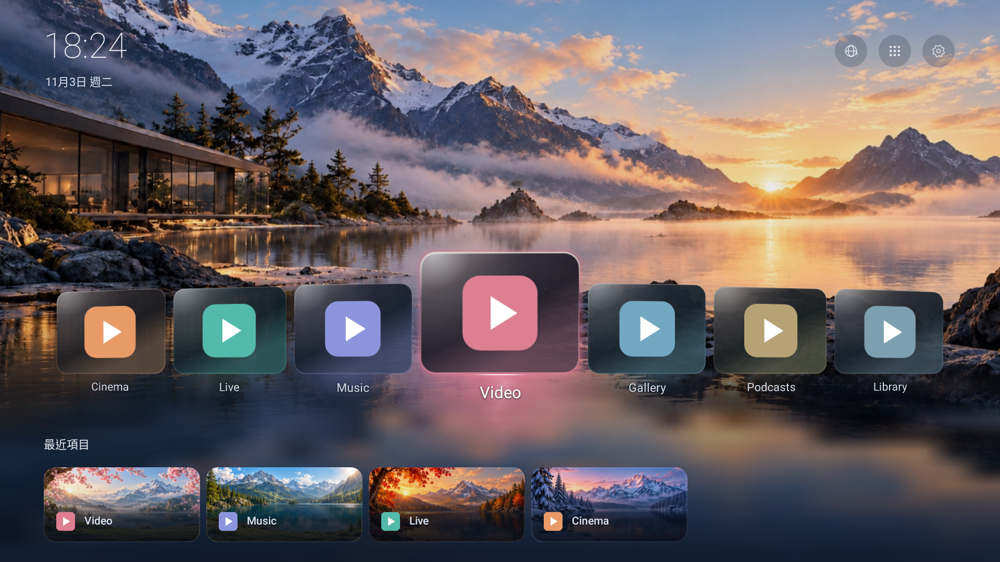

# Cinema TV

A remote-first Android TV launcher with a lightweight cinematic home screen.

[正體中文](README.zh-TW.md) · [Build](docs/BUILDING.md) · [Compatibility](docs/COMPATIBILITY.md) · [Safety and permissions](docs/SAFETY-AND-PERMISSIONS.md)

**[Download Cinema TV v73 APK](https://github.com/xd2314/CinemaTV/releases/download/v73-beta.2/CinemaTV-v73-7.0.0-beta.2-original-art.apk)** · [Release notes and SHA-256](https://github.com/xd2314/CinemaTV/releases/tag/v73-beta.2)

## Install, switch Home, and restore your original launcher

1. **Check that your TV can switch Home apps.** Cinema TV requires Android 8.0 (API 26) or newer. With your remote, look in system settings for **Default apps → Home app** or a similar picker. Confirm you can identify the original launcher. Menu paths vary by firmware. If you cannot find the picker, keep the original launcher as the default.
2. **Download and install the APK.** Transfer the `.apk` above to your TV, for example with a USB drive. Open it with a file manager and follow the Android installer. If Android asks to allow that file manager to install unknown apps, you can turn the permission off afterward. Compare the file with `SHA256SUMS` on the release page. For an update, use the maintainer-signed APK with the same signing certificate. If installation fails or Android reports a signature conflict, keep your existing installation and data. [Version and signature details](docs/BETA2-INSTALLATION.md)
3. **Try it before changing Home.** Open **Cinema TV Beta** from the original launcher's app list. Check the direction keys, OK, Back, Settings, and app list. When ready, select **Cinema TV Beta** in the system Home picker. If Cinema TV shows **Choose default home**, that option opens the same system picker.
4. **Verify with the remote.** Press the physical Home button and confirm it opens Cinema TV. Check playback and sound in the apps you use, then return and press Home again. Ordinary launcher use needs neither Root nor ADB.
5. **Switch back before uninstalling.** Select the original launcher in the same system picker, then press Home and confirm you can use it. If you want to remove Cinema TV, uninstall it in system app settings afterward. Uninstalling removes its local data. If the picker is unavailable, use the troubleshooting prompt below to identify the issue. [Restore instructions](docs/INSTALLATION.md)

Cinema TV is an independent fork derived from [CleanYourTV](https://github.com/Gathin23/cleanyourtv). It is not an official CleanYourTV, UBOX, Google, or streaming-service release.



Native-view preview with synthetic sample apps and the restored, owner-authorized original artwork; not an actual-device screenshot.

## Features

- Seven visible carousel cards, restrained perspective, glass highlights and app-color lighting.
- Explicit remote focus zones, app library/search, custom shortcut ordering and up to four real recent items.
- Paired sunrise/sunset themes, configurable automatic switching, custom wallpaper and recent-item images.
- Native settings, return-focus/scroll memory, short interruptible transitions and generated UI sounds.
- Network status shortcut and optional startup app selection.
- Collapsed developer tools for wireless ADB and experimental boot-appearance management. Ordinary launcher use needs no Root; developer tools have separate requirements and confirmations.

The public edition preserves the original project default backgrounds. The owner confirmed project-generated/owned artwork and authorized MIT redistribution; per-file hashes and the statement are recorded in [asset provenance](docs/ASSETS.md). Device records and user-selected private images remain excluded.

## AI agent prompts

Copy either prompt into ChatGPT, Codex, or another AI agent and replace the bracketed fields. You can follow along with your TV remote. Redact IP addresses, serial numbers, Wi-Fi names, and account details.

**First install and compatibility check**

```text
Help me install Cinema TV on my own TV. The model is [model], Android version is [version or unknown], and current Home app is [name or unknown].
Use the README and release assets at https://github.com/xd2314/CinemaTV. First, guide me to the TV's About screen and system Home picker, and confirm that the original launcher is available. Distinguish the minimum OS version, whether this firmware lets me select a third-party Home app, and what has been tested. Flag anything unknown.
Walk me through downloading the maintainer-signed APK, checking SHA-256, installing it manually, and trying it before I decide whether to make it the default. Ask me to verify physical Home, directional keys, OK, Back, Settings, and my usual media apps. Wait for my screen report at each step. Use the TV interface for a normal install without enabling ADB or Root.
```

**Install failure, unexpected Home behavior, or restoring the original launcher**

```text
Help me diagnose Cinema TV. I tried to [install / update / set Home / restore original Home]. My TV and Android version are [model and version]. The screen says [exact message or symptom]. Pressing physical Home opens [launcher / picker / other]. Ask me to check any missing information.
Use the docs at https://github.com/xd2314/CinemaTV. Start with the remote and check installation, installed version, picker availability, current Home, and whether the original launcher is listed. Distinguish signature conflicts, version restrictions, unavailable system pickers, and reset Home defaults. Mark suspected causes as unconfirmed. To restore the original launcher, guide me through the system picker and have me verify with physical Home.
If I already have ADB and explicitly ask to use it, verify the single device I specify and start with read-only checks of version, package, and Home. Get separate approval before any install, uninstall, data clear, or Home change. Preserve the original launcher and data. Do not scan the network, elevate privileges, reboot, or change boot assets. If there is no verified way back, stop and ask what the TV shows.
```

## Build

Requirements: JDK 21, Android SDK platform 34/build-tools 34.0.0, Python 3.9+, and the included Gradle 8.9 wrapper. First builds need access to the official dependency repositories; the app itself has no INTERNET permission.

```sh
python3 tools/check_public_tree.py
python3 -m unittest discover -s tests -v
python3 tools/build.py --unsigned
```

This runs `testReleaseUnitTest lintRelease assembleRelease`. The release APK is **unsigned by default** and cannot be installed until signed. For a locally signed debug build, use `python3 tools/build.py assembleDebug`. Read [signing and package identity](docs/BUILDING.md) first; a different certificate cannot replace an existing installation under the same package ID.

No supplied build command installs the app, chooses HOME, requests Root or changes a device. Preserve your OEM launcher and use your system's Home app picker only when ready. [Installation and return to OEM](docs/INSTALLATION.md).

## Current baseline

The public v73 APK (`7.0.0-beta.2-original-art`, versionCode 73) includes the original default wallpaper and seasonal images. Physical Home, playback, sound, and return from TTV, UPLIVE, UPMOVIE, and YouTube were checked on the test device. Other TV models, standby, reboot, prolonged use, and boot-appearance tools are still unverified. [Device acceptance](docs/BETA2-ACCEPTANCE.md) · [Compatibility](docs/COMPATIBILITY.md)

## Contribute

See [CONTRIBUTING.md](CONTRIBUTING.md), [CODE_OF_CONDUCT.md](CODE_OF_CONDUCT.md), [SECURITY.md](SECURITY.md) and the issue templates. CI builds/tests the source without release signing credentials and never creates a public release automatically.

## License

Project code and original generated artwork/audio: [MIT](LICENSE), preserving Copyright 2026 Gathin and Cinema TV contributors. Fonts, emoji and dependency licenses are listed in [THIRD_PARTY_NOTICES.md](THIRD_PARTY_NOTICES.md). Third-party apps, firmware, credentials and media content are not included.
