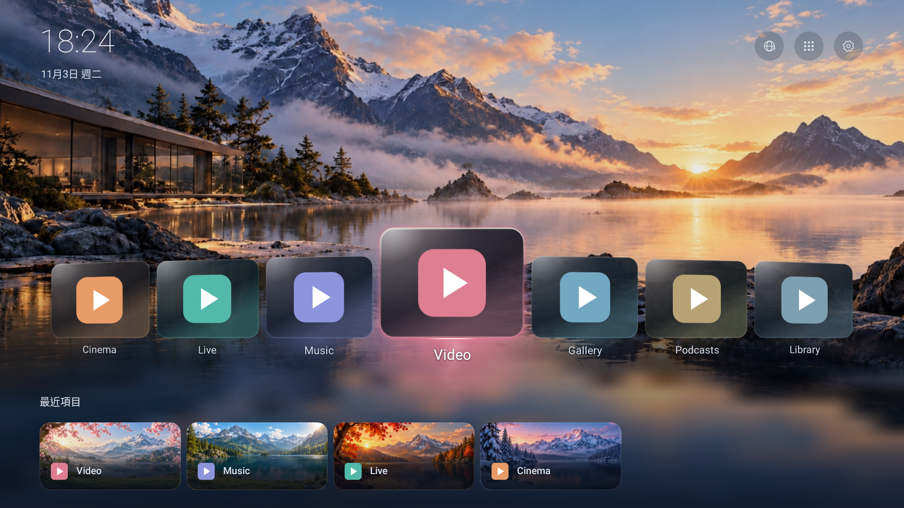

# Cinema TV

適合電視遙控器操作的輕量電影風格首頁。

[English](README.md) · [建置說明](docs/BUILDING.md) · [相容範圍](docs/COMPATIBILITY.md) · [權限與安全](docs/SAFETY-AND-PERMISSIONS.md)

這是從 [CleanYourTV](https://github.com/Gathin23/cleanyourtv) 衍生的獨立專案，保留原作者及第三方授權；不代表原專案、安博、Google 或影音服務的官方產品。



原生View預覽，使用合成範例App與已恢復、經PO授權的原始圖片；不是實機截圖。

## 主要功能

- 七格可見 App Carousel、玻璃材質、輕微透視及 App 主色光暈。
- 明確的 DPAD 焦點區域、應用程式清單／搜尋、捷徑排序、最多四個真實最近項目。
- 日出／日落配對主題、時間切換、自訂首頁及最近項目背景。
- 原生設定介面、返回焦點／捲動記憶、可中斷短動畫及可重建的操作音效。
- 網路狀態捷徑與開機自動開啟 App。
- 預設收合的開發工具：啟動無線連接、實驗性開機素材管理。一般首頁不需要 Root；開發工具須分別確認條件與風險。

公開版保留原本的預設圖片；PO已確認這組圖片為專案生成／自有素材，並同意MIT公開散布。逐張原圖雜湊與來源聲明見[素材說明](docs/ASSETS.md)。設備備份、私人事故收據與使用者另選的私人圖不包含。

## 本機建置

需要 JDK21、Android SDK34／Build Tools34.0.0、Python3.9以上；Gradle8.9 Wrapper 已包含。第一次建置需要下載官方依賴，App 本身沒有 INTERNET 權限。

```sh
python3 tools/check_public_tree.py
python3 -m unittest discover -s tests -v
python3 tools/build.py --unsigned
```

預設執行測試、Lint 與 release 建置。release 預設未簽章，不能直接安裝。一般開發者可執行 `python3 tools/build.py assembleDebug` 取得本機 debug 簽章版。[簽章與套件識別說明](docs/BUILDING.md)

公開程式碼不需要你的私人 `.jks`／`.keystore` 或密碼。不同簽章不能直接覆蓋同套件的既有安裝；不要為此先移除目前正在使用的首頁或清除資料。

## 安裝與回退

先保留原廠 Launcher，確認系統有可操作的預設首頁入口，再自行決定是否安裝、選取 HOME。[安裝與回原廠首頁](docs/INSTALLATION.md)

本專案不附自動安裝、Debloat、關閉原廠服務或自動 HOME 指派腳本；建置及 CI 不會連線盒子。

## 版本與驗證

目前來源 `7.0.0-beta.2-original-art`／versionCode73，以私人v71程式碼為基礎，顯示名稱為Cinema TV Beta。已準備維護者簽署的側載APK，散布前請核對[Beta安裝說明](docs/BETA2-INSTALLATION.md)與當次驗證結果。本版已恢復原始預設圖片，簽章與歷史資料的公開化處理仍須區分；當次驗收另行記錄，不改寫歷史結果。

查看[本輪建置結果與發布條件](docs/RELEASE-READINESS.md)、[相容範圍](docs/COMPATIBILITY.md)。安博9／10為原型測試經驗，不保證同商品名的所有韌體、Root寫入、待機與重啟都相同。

## 授權與參與

程式碼及本專案原創素材採 [MIT](LICENSE)，保留原作者Gathin；Outfit字型採OFL，Fluent Emoji另附MIT聲明。[第三方聲明](THIRD_PARTY_NOTICES.md)

歡迎參考 [CONTRIBUTING.md](CONTRIBUTING.md) 與 Issue 範本提供問題；回報時請移除IP、序號、帳號、Wi-Fi名稱與私人素材。[SECURITY.md](SECURITY.md)
